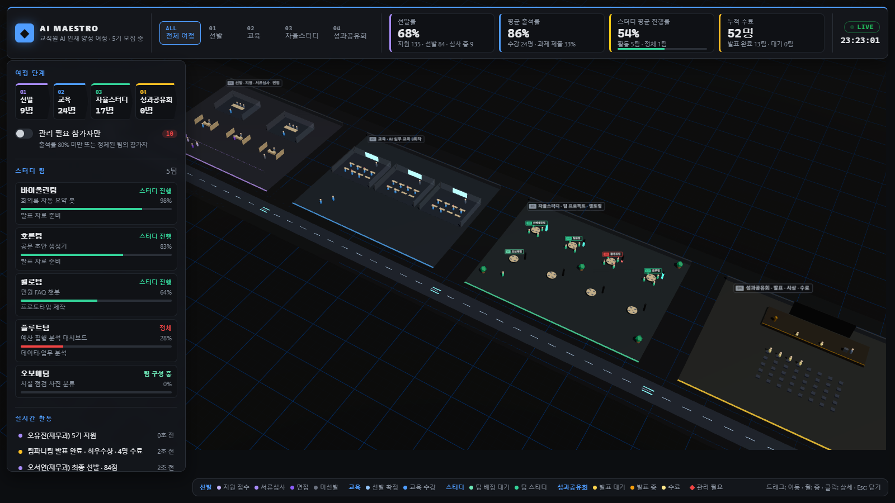

# AI Maestro · 교직원 AI 인재 양성 여정

교직원 대상 **AI 마에스트로** 프로그램의 전 과정 **선발 → 교육 → 자율스터디 → 성과공유회**를
실시간 전략(RTS) 게임처럼 내려다보며 관제하는 3D 앱입니다.
참가자 한 명 한 명이 지원부터 수료까지 도로를 따라 각 단계 구역을 걸어서 이동합니다.
React Three Fiber + drei + Zustand + TypeScript + Vite.

- **라이브 데모:** https://3d-ai-maestro.vercel.app
- **GitHub:** https://github.com/jyseok0311/3d-ai-maestro

`main` 브랜치에 푸시하면 Vercel이 자동으로 프로덕션에 배포합니다.



## 실행

```bash
npm install
npm run dev        # http://localhost:5173
npm run typecheck  # 타입 체크
npm run build      # 프로덕션 빌드 (dist/)
```

주소 끝에 `#selection`, `#training`, `#study`, `#showcase`를 붙이면 해당 단계에서 바로 시작합니다.

## 조작

| 동작 | 입력 |
| --- | --- |
| 지도 이동 | 마우스 드래그 |
| 줌 | 마우스 휠 |
| 단계 이동 | 상단 01–04 탭 또는 KPI 카드 클릭 |
| 상세 보기 | 참가자·심사 부스·면접실·강의실·스터디 테이블·무대 클릭, 팀 목록·활동 로그 클릭 |
| 선택 해제 | 빈 곳 클릭 또는 `Esc` |

## 여정과 화면

| 단계 | 구역 | 참가자 흐름 | KPI |
| --- | --- | --- | --- |
| 01 선발 | 입장 대기줄, 서류심사 부스 3, 면접실 2 | 지원 접수 → 서류심사 → 면접 → 선발 확정 (미선발자는 입구로 퇴장) | 선발률 |
| 02 교육 | AI 강의실 3 (각 8석) | 8회차 수업 출석 + 과제 4개 제출 시 이수 | 평균 출석률 |
| 03 자율스터디 | 스터디 테이블 8, 팀별 진행률 타워 | 4명이 팀을 이루어 주제 프로젝트 진행, 가끔 정체되면 멘토가 해소 | 스터디 평균 진행률 |
| 04 성과공유회 | 발표 무대, 관람석 40 | 발표 준비가 끝난 팀이 관람석에서 대기 → 한 팀씩 발표 → 시상·수료 후 퇴장 | 누적 수료 인원 |

- 스터디 팀은 오케스트라 악기 이름(바이올린팀, 첼로팀…)을 씁니다. 마에스트로가 지휘하는 오케스트라라는 콘셉트입니다.
- **관리 필요 참가자:** 출석률 80% 미만인 수강생, 진행이 정체된 팀의 팀원. 머리 위에 빨간 마름모가 뜨고 필터로 따로 볼 수 있습니다.
- **좌측 패널:** 단계별 인원(클릭하면 그 단계만 표시), 팀 진행 현황, 실시간 활동 로그.

## 코드 구조

| 폴더 | 내용 |
| --- | --- |
| `src/data/` | 데이터 모델(Stage·Facility·Participant·Team·ActivityEvent), 구역 배치도와 좌석 좌표, 이름 풀, 시드 데이터(참가자 약 57명, 팀 6개) |
| `src/sim/` | 2초마다 실행되는 순수 함수 시뮬레이션 (바뀐 레코드만 교체, 신규 지원자 유입·퇴장 처리) |
| `src/store/` | Zustand 스토어, KPI·필터·관리 필요 판정 |
| `src/scene/` | 3D 씬: 카메라(드래그·휠·맵 경계·단계 이동), 4개 구역 모델, 참가자 인스턴싱(전원 3 draw call), 도로 경로 이동 |
| `src/ui/` | 상단 바, 좌측 패널, 상세 패널, 범례 |

> 시뮬레이션 시간은 압축되어 있어 지원부터 수료까지 몇 분 안에 진행됩니다.
> 참가자·부서·멘토·프로젝트 주제는 모두 시연용 가상 데이터입니다.
